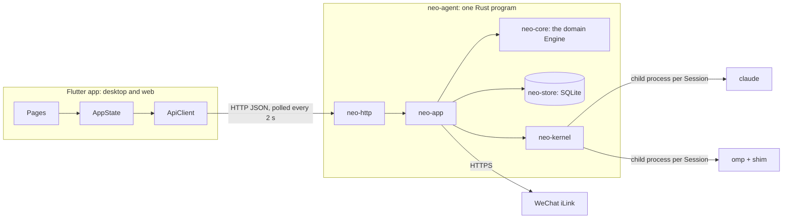

# 007 Architecture

This document maps the code. It builds on [006 Deployment](006-deployment.md).

## Shape

The backend and the interface are separate programs that share only the HTTP API. The desktop app starts the backend as a child process; a server runs the backend alone and serves the web build of the same app.

## Closed loop

1. A chat message arrives: over the API, or from the WeChat long poll. It is written to the main Session's journal and received as a Trigger.
2. The Engine's gate decides its strength; a pass queues an **assessment** effect, which delivers a candidate card to the main Session.
3. The main Session routes it with a tool call: accept, attach, sidecar, stop or ignore. An accept creates a Ticket with a Mandate and queues a **launch** effect; an acknowledgement goes to the Outbox.
4. The Executor prepares the Ticket's directory and opens its worker, whose reports reach the Engine through its tools. Later Inputs travel by the Ticket's **delivery** effect.
5. A report that matters is **relayed** to the main Session, which replies through the Outbox; a **reply** effect sends each message to its conversation.

## Persistence and delivery

- **One SQLite database** holds the domain as JSON documents with generated columns and partial indexes for what is queried. Engine commands run in transactions that nest as savepoints; what must happen only after a commit — queueing an effect's wake-up, for one — is registered and runs then.
- **Effects** are durable rows: a kind, a key, a payload, and when to try next. A handler that fails with "later" is tried again with a growing wait and shows as waiting; one that fails three times shows as an error and is still retried. Some kinds run one at a time in order (relays, notices); launches are limited by the worker slots.
- **Journals** make delivery to a Session idempotent by request id, as [005 Sessions](005-sessions.md) says.
- **The Outbox** records each outbound message once by id, and marks it sent, gone or waiting.

## Concurrency and shutdown

The Engine is synchronous and runs under the store's lock, one command at a time. Everything that waits — runtimes, the network, timers — is asynchronous and calls the Engine in short steps. Each Session's runtime is a child process in its own process group, read by one task.

Stopping goes in order: no new passes, the Watchdog and the WeChat poll end, every Session is barred from new work and closed, running effects finish. Waiting effects stay in the database for the next start.

## Dependencies

The backend depends on: `tokio` (processes, sockets, timers), `rusqlite` with SQLite bundled, `serde` and `serde_json`, `ureq` with rustls (the outbound HTTPS calls), `sha2`, `aes`, `base64`, `getrandom` and `libc`. The HTTP server, the command line, MD5 for WeChat uploads, UUIDs and the word count are written here.

The app depends on: `cupertino_ui` (Flutter's Cupertino widgets), `cupertino_icons`, `http`, `file_selector` and `web`. Its state is a `ChangeNotifier`; its QR code encoder and its two languages are written here.

## Modules

| Files | Responsibility |
| --- | --- |
| `backend/crates/neo-core/src/lib.rs`, `model.rs`, `ports.rs`, `errors.rs`, `reasons.rs`, `ids.rs`, `time.rs` | The domain's types, the ports the Engine needs, errors with their reasons, stable ids, time |
| `backend/crates/neo-core/src/engine.rs`, `intake.rs`, `evals.rs`, `tickets.rs`, `assignments.rs`, `replies.rs`, `stage.rs` | The Engine: receiving Triggers, Evals and Decisions, Tickets and follow-ups, Assignments and reports, replies, a Ticket's stage |
| `backend/crates/neo-core/src/memory.rs` | An in-memory repository, for the Engine's tests |
| `backend/crates/neo-store/src/lib.rs`, `read.rs`, `receipts.rs`, `effects.rs` | The SQLite repository and its transactions, read models, Outbox receipts, effect rows |
| `backend/crates/neo-kernel/src/lib.rs`, `types.rs`, `journal.rs`, `session.rs`, `process.rs` | What a kernel is to the application: messages and events, the journal, the kernel-neutral Session, child processes |
| `backend/crates/neo-kernel/src/claude.rs`, `omp.rs` | The two kernels' protocols |
| `backend/crates/neo-app/src/lib.rs`, `app.rs`, `settings.rs`, `policy.rs`, `health.rs`, `text.rs`, `http.rs` | The application value and its wiring, settings, the Policy the settings make, component health, text limits, the outbound HTTP client |
| `backend/crates/neo-app/src/effects.rs`, `passes.rs`, `outbox.rs`, `notices.rs` | The effect queue, orchestration passes, outbound messages, notices and relays to the main Session |
| `backend/crates/neo-app/src/kernels.rs`, `sessions.rs`, `prompts.rs`, `tools.rs`, `resources.rs`, `cards.rs`, `assess.rs` | Launching runtimes per role, Sessions and the conversation, prompts, the tools of each role, readable resources, cards, candidate delivery and assessment |
| `backend/crates/neo-app/src/executor.rs`, `blocked.rs`, `sidecar.rs`, `watchdog.rs`, `procinfo.rs` | The Executor, blocked commands, the Sidecar, the Watchdog and its process sampling |
| `backend/crates/neo-app/src/chat.rs`, `wechat.rs`, `wechat_protocol.rs`, `wechat_typing.rs`, `views.rs` | The chat Source, the WeChat bridge, its protocol and its typing indicator (a model-free loop showing "typing" while the main Session or a worker is at work), what the API shows and changes |
| `backend/crates/neo-http/src/lib.rs`, `server.rs`, `api.rs` | The HTTP server, the API's routes, access control, the web app's files |
| `backend/crates/neo-agent/src/main.rs`, `cli.rs`, `paths.rs`, `instance.rs` | The program: its commands, the command line, where things are on a machine, the single instance |
| `backend/crates/neo-testkit/src/lib.rs`, `http.rs`, `models.rs`, `backend/crates/neo-testkit/src/bin/fixture-model.rs` | Test support: temporary directories, a loopback server, fake model endpoints, and one as a program |
| `shim/neo-omp-shim.ts` | The Oh My Pi extension: the tool-call guard and background-job control |
| `app/lib/main.dart` | The app's entry and root widget |
| `app/lib/src/api/client.dart`, `models.dart` | The API client and what it carries |
| `app/lib/src/state/app_state.dart` | Connection and polled state |
| `app/lib/src/platform/host.dart`, `host_io.dart`, `host_web.dart`, `host_stub.dart` | Where the app runs: the desktop's backend process and single instance, the browser's origin and storage |
| `app/lib/src/ui/shell.dart`, `chat_page.dart`, `workers_page.dart`, `settings_page.dart`, `activity_ticker.dart`, `scope.dart`, `widgets.dart`, `theme.dart`, `format.dart` | The frame and the three pages, the bottom-right ticker of what is at work, shared widgets, the look, message formatting |
| `app/lib/src/qr/qr_code.dart`, `qr_view.dart` | The QR code encoder and its painter |
| `app/lib/src/l10n/strings.dart` | The app's words in Chinese and English |

## Tests

| Files | Coverage |
| --- | --- |
| `backend/crates/neo-core/tests/engine.rs`, `tickets.rs`, `lifecycle.rs` | The Engine over the in-memory repository |
| `backend/crates/neo-store/tests/core_engine.rs`, `store.rs` | The same Engine tests over SQLite; transactions, receipts, read models, effect rows, the schema version |
| `backend/crates/neo-kernel/tests/session.rs` | The kernel-neutral Session and journal over a scripted driver |
| `backend/crates/neo-kernel/tests/claude_real.rs`, `omp_real.rs` | Each kernel's protocol against the real runtime and a fake model endpoint (opt-in) |
| `backend/crates/neo-app/tests/policy.rs`, `effects.rs` | The gate and Policy changes; the effect queue |
| `backend/crates/neo-app/tests/flow.rs`, `work.rs`, `watchdog.rs`, `views.rs` | The application over a scripted kernel: the whole path of a request, workers at work, the Watchdog, what the API shows and changes |
| `backend/crates/neo-app/tests/wechat.rs` | The WeChat bridge against a stand-in for its API |
| `backend/crates/neo-http/tests/api.rs` | Every route's contract, access control, static files, the protocol's edges |
| `backend/crates/neo-agent/tests/process.rs`, `real.rs`, `docs.rs` | The program as a process; the product end to end with a real kernel (opt-in); these documents |
| `app/test/qr_code_test.dart`, `logic_test.dart`, `app_test.dart`, `host_io_test.dart`, `fake_backend.dart` | The QR encoder against an independent one; formatting, models, client and state; every page over a fake backend; the desktop host with real processes, the real backend among them |
| `packaging/e2e/web-e2e.mjs`, `run-web-e2e.sh` | The web app in a real browser against the real backend and a real kernel |
