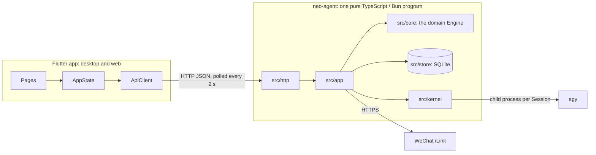

# 007 Architecture

This document maps the code. It builds on [006 Deployment](006-deployment.md).

## Shape

The backend and the interface are separate programs that share only the HTTP API. The desktop app starts the backend as a child process; a server runs the backend alone and serves the web build of the same app.

## Closed loop

1. A chat message arrives: over the API, or from the WeChat long poll. It is written to the main Session's journal and received as a Trigger.
2. The Engine's gate decides its strength; a pass queues an **assessment** effect, which delivers a candidate card to the main Session.
3. The main Session routes it with a tool call: accept, attach, sidecar, stop or ignore. An accept creates a Ticket with a Mandate and queues a **launch** effect; an acknowledgement goes to the Outbox.
4. The Executor prepares the Ticket's directory and opens its worker, whose reports reach the Engine through its tools. Later Inputs travel by the Ticket's **delivery** effect.
5. A report that matters is **relayed** to the main Session, which replies through the Outbox; a **reply** effect sends each message to its conversation.

## Persistence and delivery

- **One SQLite database** (`bun:sqlite`, schema version 100) holds the domain as JSON documents with generated columns and partial indexes for what is queried, using WAL mode, `synchronous=NORMAL`, `mmap_size`, and cached prepared statements. Engine commands run in synchronous transactions that nest as savepoints; what must happen only after a commit — queueing an effect's wake-up, for one — is registered and runs then.
- **Effects** are durable rows: a kind, a key, a payload, and when to try next. Dispatch is purely event-driven (`wakeKind` + earliest-due timer). A handler that fails with "later" is tried again with a growing wait and shows as waiting; one that fails three times shows as an error and is still retried. Some kinds run one at a time in order (relays, notices); launches are limited by the worker slots.
- **Journals** make delivery to a Session idempotent by request id with O(1) in-memory indexes, single-byte tail checks, and cached recent slices, as [005 Sessions](005-sessions.md) says.
- **The Outbox** records each outbound message once by id, and marks it sent, gone or waiting, supporting concurrent delivery slots with `waitFor` settlement notification.

## Concurrency and shutdown

The Engine is synchronous on the single-threaded event loop, one atomic command at a time with zero lock contention. Everything that waits — child processes, loopback TCP, outbound HTTPS, timers — is asynchronous and calls the Engine in short steps. Each Session's runtime is a child process in its own process group. The compiled binary (`bun build --compile --minify --bytecode`) uses lazy loading so `agy-hook` and `worker-bin` stand-in invocations execute in under 9 ms without loading the server modules.

Stopping goes in order: no new passes, the Watchdog and the WeChat poll end, every Session is barred from new work and closed, running effects finish. Waiting effects stay in the database for the next start.

## Dependencies

The backend is 100% pure TypeScript with **zero third-party runtime dependencies**, using only Bun and Node built-ins (`bun:sqlite`, `bun:ffi` for OS `flock`, `node:net`, `node:crypto`, `node:fs`, `node:child_process`, pooled `fetch`, and static text imports for embedded prompts). Only `@types/bun` is used as a devDependency for strict `bun check`.

The app depends on: `cupertino_ui` (Flutter's Cupertino widgets), `cupertino_icons`, `http`, `file_selector` and `web`. Its state is a `ChangeNotifier`; its QR code encoder and its two languages are written here.

## Modules

| Files | Responsibility |
| --- | --- |
| `backend/src/version.ts`, `main.ts`, `types.d.ts` | Version constant, minimal fast-path entry (`worker-bin` refusal, `agy-hook` relay, lazy CLI load), embedded markdown text types |
| `backend/src/core/index.ts`, `model.ts`, `ports.ts`, `errors.ts`, `reasons.ts`, `ids.ts`, `time.ts` | The domain's types, the ports the Engine needs, errors with their reasons, stable ids, time |
| `backend/src/core/engine.ts`, `intake.ts`, `evals.ts`, `tickets.ts`, `assignments.ts`, `replies.ts`, `stage.ts` | The Engine: receiving Triggers, Evals and Decisions, Tickets and follow-ups, Assignments and reports, replies, a Ticket's stage |
| `backend/src/core/memory.ts` | An in-memory repository with nested rollback, for the Engine's tests |
| `backend/src/store/index.ts`, `read.ts`, `receipts.ts`, `effects.ts` | The SQLite repository (`bun:sqlite`, schema 100) and its savepoint transactions, read models, Outbox receipts, effect rows |
| `backend/src/kernel/index.ts`, `types.ts`, `journal.ts`, `session.ts`, `process.ts` | What a kernel is to the application: messages and events, O(1)-indexed journal, Session wrapper, process-group child processes |
| `backend/src/kernel/antigravity.ts` | The Antigravity CLI protocol: writes the Session's bridge (agent, plugin, hooks) and serves the host's tools and hooks on loopback with `TCP_NODELAY` |
| `backend/src/app/index.ts`, `app.ts`, `context.ts`, `kernel-types.ts`, `settings.ts`, `policy.ts`, `health.ts`, `text.ts`, `http.ts` | The application value and its wiring, shared context contract, settings, Policy, component health, Unicode word limits, outbound HTTP client |
| `backend/src/app/effects.ts`, `passes.ts`, `outbox.ts`, `notices.ts` | Event-driven effect queue, orchestration passes, outbound messages, notices and relays to the main Session |
| `backend/src/app/kernels.ts`, `sessions.ts`, `prompts.ts`, `tools.ts`, `resources.ts`, `cards.ts`, `assess.ts` | Launching Antigravity per role, Sessions and per-session locks, embedded prompts, JSON-Schema tools, readable resources, cards, candidate delivery and assessment |
| `backend/src/app/recall.ts`, `artifacts.ts`, `clarification.ts`, `access.ts` | Historical ticket anti-noise retrieval index (CJK 2-gram + `Intl.Segmenter` + atomic numerals + IDF), deliverable artifact collector, pre-route clarification state, and cross-surface/sidecar access control |
| `backend/src/app/accounts.ts`, `keyring.ts` | Antigravity's Google account status (OS keyring, login file, CLI fallback), piped `acp --login` flow, and logout |
| `backend/src/app/executor.ts`, `blocked.ts`, `sidecar.ts`, `watchdog.ts`, `procinfo.ts` | The Executor, blocked command stand-ins, Sidecar, Watchdog, and direct `/proc` process sampling |
| `backend/src/app/chat.ts`, `wechat.ts`, `wechat_protocol.ts`, `wechat_typing.ts`, `views.ts` | The chat Source, WeChat iLink bridge, AES-128-ECB CDN protocol, idle-skipping typing loop, and cached API views |
| `backend/src/devices/index.ts`, `types.ts`, `cbor.ts`, `protocol.ts`, `relay-client.ts`, `manager.ts`, `enrollment.ts` | Multi-device control plane: `neo1` tokens, 10-byte relay frames, AES-256-GCM E2E, Zero-Trust `0xE2` one-click enrollment, MCU HMAC-SHA256 + CBOR + Tier 1-driven MCU installation, relay client, Device Twins, Deep Sleep queues, risk approvals, and S3 cluster prefix isolation |
| `backend/src/http/index.ts`, `server.ts`, `api.ts` | Raw `node:net` HTTP/1.1 keep-alive server with `TCP_NODELAY`, API routes, constant-time token & origin control, CSP static web serving |
| `backend/src/agent/cli.ts`, `paths.ts`, `instance.ts`, `hook-fast.ts`, `runner.ts` | Command-line parser, machine paths, OS `flock` single-instance lock, zero-import `agy-hook` relay, lazy-loaded CLI runner |
| `backend/src/testkit/index.ts`, `fixture-agy.ts` | Test support: temporary directories, mock loopback HTTP server, scripted kernel, and standalone pure-TS `fixture-agy` stand-in |
| `backend/benchmarks/perf.ts`, `routing-eval.ts` | Reproducible latency/throughput benchmarks (Store, Engine, Journal, HTTP, `agy-hook`, `worker-bin`, `/proc`, text, recall index) and L3 real-LLM routing evaluation sandbox |
| `app/lib/main.dart` | The app's entry and root widget |
| `app/lib/src/api/client.dart`, `models.dart` | The API client and what it carries |
| `app/lib/src/state/app_state.dart` | Connection and polled state |
| `app/lib/src/platform/host.dart`, `host_io.dart`, `host_web.dart`, `host_stub.dart` | Where the app runs: the desktop's backend process and single instance, the browser's origin and storage |
| `app/lib/src/ui/shell.dart`, `chat_page.dart`, `workers_page.dart`, `devices_page.dart`, `device_enroll_sheet.dart`, `settings_page.dart`, `accounts_settings.dart`, `activity_ticker.dart`, `scope.dart`, `widgets.dart`, `theme.dart`, `format.dart` | The frame and the four pages (including multi-device fleet, one-click agent command generator, and Tier 1-driven MCU installation), activity ticker, shared widgets, theme, message formatting |
| `app/lib/src/qr/qr_code.dart`, `qr_view.dart` | The QR code encoder and its painter |
| `app/lib/src/l10n/strings.dart` | The app's words in Chinese and English |

## Tests

| Files | Coverage |
| --- | --- |
| `backend/tests/core/engine.test.ts`, `tickets.test.ts`, `lifecycle.test.ts` | The Engine over the in-memory repository |
| `backend/tests/store/core_engine.test.ts`, `store.test.ts`, `search.test.ts` | The same Engine tests over SQLite; savepoints, receipts, generated columns, read models, effect rows, schema version, and L1 historical recall/adversarial gates |
| `backend/tests/kernel/session.test.ts`, `antigravity_lifecycle.test.ts` | The Session, O(1) journal, process groups, and Antigravity driver lifecycle with a pure-TS stand-in and real `relayHook` |
| `backend/tests/app/utils.test.ts`, `cards_notices.test.ts`, `kernels_accounts.test.ts`, `keyring.test.ts`, `policy.test.ts`, `effects.test.ts`, `wechat_protocol.test.ts`, `clarification_access.test.ts` | Utilities, prompts, blocked commands, `/proc`, cards/notices, kernels/accounts/keyring, gate & Policy, effect queue & Outbox, WeChat crypto/protocol, pre-route clarification & access control |
| `backend/tests/app/flow.test.ts`, `work.test.ts`, `watchdog.test.ts`, `views.test.ts`, `wechat.test.ts`, `recall_routing.test.ts` | Full application over a scripted kernel: end-to-end request flows, workers, Watchdog, API views, WeChat bridge, and L2 historical recall/clarify/security integration flows |
| `backend/tests/devices/protocol.test.ts`, `manager.test.ts`, `enrollment.test.ts` | Multi-device wire protocol vectors (`neo1`, binary frames, E2E AEAD, `0xE2` enrollment, MCU HMAC/CBOR, S3 prefix isolation), `DeviceManager` twin persistence, failover, Deep Sleep queue, risk approvals, Zero-Trust enrollment & Tier 1-driven MCU install, tools, and HTTP API routes |
| `backend/tests/http/server.test.ts`, `api_unit.test.ts`, `api.test.ts` | HTTP/1.1 framing edge cases, access control, static files, and all API routes against a real `App` |
| `backend/tests/agent/unit.test.ts`, `process.test.ts`, `docs.test.ts` | CLI/paths/OS-lock/fast-hook units, compiled `dist/neo-agent` + `dist/fixture-agy` process tests, and documentation invariants |
| `app/test/qr_code_test.dart`, `logic_test.dart`, `app_test.dart`, `devices_test.dart`, `host_io_test.dart`, `fake_backend.dart` | The QR encoder, formatting, models, client and state, every page (including multi-device enrollment and MCU installation) over a fake backend, and desktop host with the real compiled backend |
| `packaging/e2e/web-e2e.mjs`, `run-web-e2e.sh` | The web app in a real browser against the real backend and the fixture stand-in |
